

  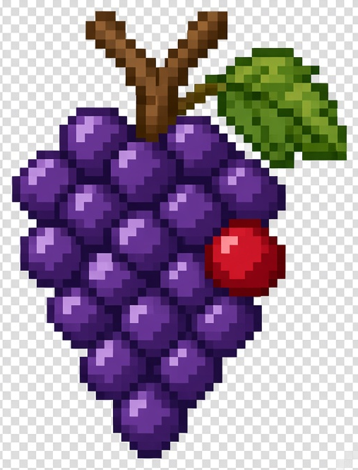

# GrapeAncestry
[English](README.md)

GrapeAncestry v1.1.0 将新的葡萄样本比对到基于 VS-1 参考基因组构建的 2449 × 167K 固定（frozen）面板上，并生成交互式 HTML 报告。多个样本可以合并在同一份报告中。

代码采用 MIT 许可。面板的基因型和表型数据不受 MIT 许可约束（详见 [`DATA_NOTICE.md`](DATA_NOTICE.md)）。作者：李旭真，[ORCID 0000-0003-3670-6657](https://orcid.org/0000-0003-3670-6657)。

  <a href="https://xuzhen-li.github.io/grapeancestry/demo/results/ramos2019_np.batch.report.html">打开演示报告</a> 
  28 颗考古葡萄籽，Ramos-Madrigal et al. 2019 <em>Nat. Plants</em>

## v1.1 更新

v1.1 增加了批量查询的亲缘关系网络图。新输入的样本与匹配到的面板品种会被绘制在同一张图上。这些样本也会在 PCA、ADMIXTURE 和 NJ 树中联合展示。下图为 28 颗考古种子演示报告中的关系图。

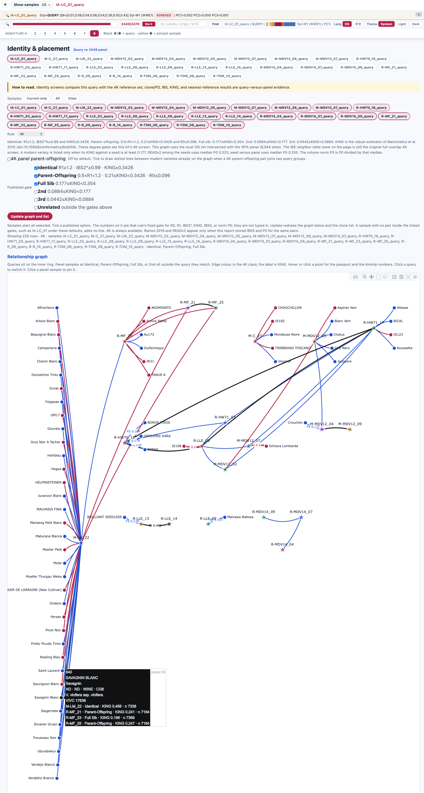

v1.1 新功能。蓝色节点为输入样本，红色节点为面板品种。连线颜色代表亲缘关系级别（相同克隆、亲子、全同胞及更远关系）。[打开在线报告](https://xuzhen-li.github.io/grapeancestry/demo/results/ramos2019_np.batch.report.html)。

## 分析流程

输入 FASTQ、BAM 或 VCF 文件。流程将序列比对至 VS-1，标记重复，并在 167,433 个目标位点进行 SNP calling。随后计算质控、亲缘关系、PCA、ADMIXTURE、NJ 树以及 aDNA 损伤，最终生成交互式报告。

输入、处理、分析与交互式报告概览。分析中使用的参考数据包括核心基因型、固定 PCA/ADMIXTURE 参考、VIVC 护照数据及 OIV 描述符。具体步骤及推论边界见 [`docs/FLOWCHART.md`](docs/FLOWCHART.md)。VS-1 参考基因组：Dong et al. 2023 Science ([doi:10.1126/science.add8655](https://doi.org/10.1126/science.add8655))。

## 概览

- 接收 FASTQ、已比对至 VS-1 的 BAM，或在 167K 面板位点 calling 的 VCF 文件
- 将样本投射至固定的 2449 样本 × 167K 位点的 VS-1 面板上
- 筛查克隆与亲子关系，并报告与面板样本的 IBS 亲缘关系
- 将样本投影到固定的 PCA 轴和 ADMIXTURE K=2–8 结构上，并绘制 NJ 树
- 批量报告包含上述 v1.1 亲缘关系图，以及联合的 PCA、ADMIXTURE 和 NJ 树位置
- 汇总古代样本的 aDNA 损伤模式
- 报告 OIV 225 果皮颜色基因组得分（得分 ≠ 表型）
- 为每个样本生成一个独立的 HTML 报告。工具套件在本地通过 Docker 运行

## 使用方法

| 路径 | 操作 | 结果 |
|------|-------------|---------|
| Docker 套件 | 从 Zenodo Restricted ([doi:10.5281/zenodo.22868632](https://doi.org/10.5281/zenodo.22868632)) 下载 `grapeancestry-v1.1.0-amd64.tar`，放在 `./start.sh` 同级目录，并运行 | 产出 `*.sample-first-v2.report.html`，UI <http://127.0.0.1:8501>，报告端口 8502 |
| 演示 | [打开 28 颗种子报告](https://xuzhen-li.github.io/grapeancestry/demo/results/ramos2019_np.batch.report.html)。 | 仅供浏览。Ramos-Madrigal et al. 2019, *Nat. Plants* ([doi:10.1038/s41477-019-0437-5](https://doi.org/10.1038/s41477-019-0437-5)) |
| 手动构建 | 准备你自己的 VS-1 和固定的 2449×167K 资源（不在 git 中）。CLI: `pip install -e .`（见 docs/USER_GUIDE.md §5） | 遵循 [`steps/`](steps/) `00a`–`13b` |

### Docker 套件

1. 安装 [Docker Desktop for Windows](https://docs.docker.com/desktop/setup/install/windows-install/) 或 [Docker Desktop for Mac](https://docs.docker.com/desktop/setup/install/mac-install/)。在 Apple Silicon Mac 上，需在 Docker Desktop 设置中开启 x86_64/amd64 模拟。
2. 下载本仓库（绿色 Code 按钮，然后 Download ZIP）并下载镜像包 `grapeancestry-v1.1.0-amd64.tar`（约 1.7 GB）。将镜像包放入解压后的文件夹中。
3. Mac: 双击 `start.command`。Windows: 双击 `start.bat`。Linux / 终端: `./start.sh`
4. 浏览器将打开 <http://127.0.0.1:8501>。首次访问需设置本地密码，随后选择文件，开始分析，并打开报告（端口 8502）。报告副本保存在 `output/results/` 中。

Docker 简易命令：`./start.sh`（macOS 用 `start.command`，Windows 用 `start.bat`）会创建 `input/`、`output/` 和 `settings/` 文件夹。如果缺失则加载 `grapeancestry:1.1.0` 并启动 UI。仅包含文档但没有 tar 包的仓库无法完成分析步骤。请勿对该大型镜像执行 `docker push`。详情见 [`docs/USER_GUIDE.md`](docs/USER_GUIDE.md)。

v1 版本的最终输出仅限 `*.sample-first-v2.report.html`（云端的 `chip.json` 不属于 v1 内容）。

## 输出结果

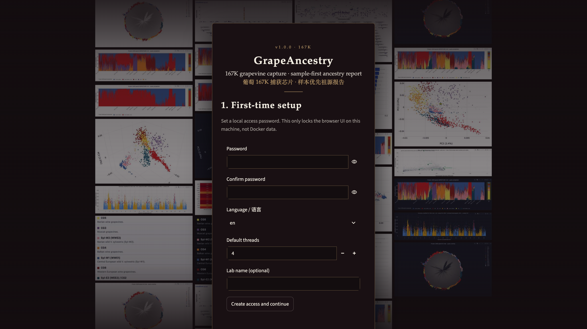

首次运行设置：本地密码、语言及线程数（仅锁定 UI 访问权限，不对数据加密）。

`demo/results/` 下的文件为 28 颗种子的批量报告。下面的截图来自 Ages 报告。Docker 套件中附带了 `HUN89_query`（面板 ID `HUN89` ≠ 报告前缀 `HUN89_query`）。阅读指南：[`docs/GUIDELINE.md`](docs/GUIDELINE.md)。Ages/V5 引用：Noraz et al. 2026 *Nat Commun* ([doi:10.1038/s41467-026-70166-z](https://doi.org/10.1038/s41467-026-70166-z))。28 颗种子引用：Ramos-Madrigal et al. 2019 *Nat. Plants* ([doi:10.1038/s41477-019-0437-5](https://doi.org/10.1038/s41477-019-0437-5))。

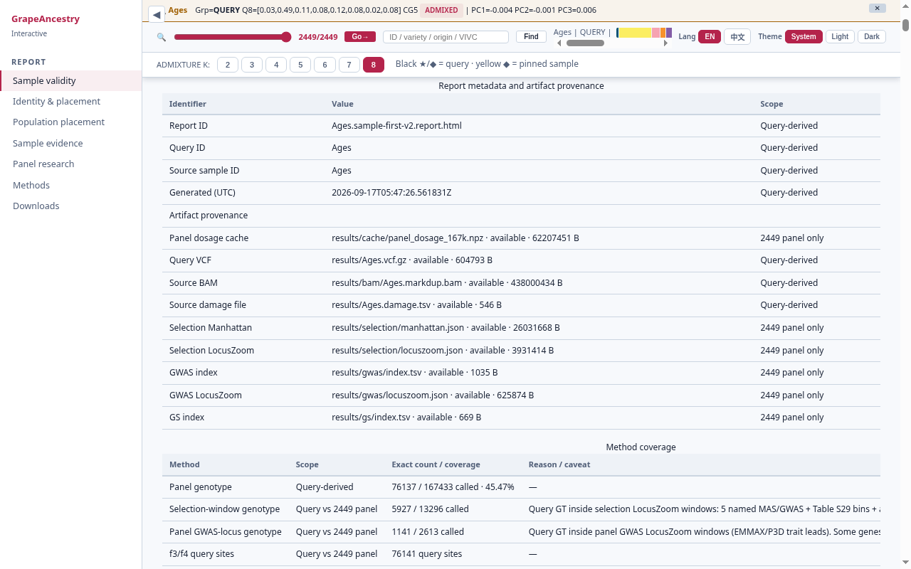

样本有效性：Ages aDNA 演示报告的元数据与方法覆盖度（V5; Noraz et al. 2026）。

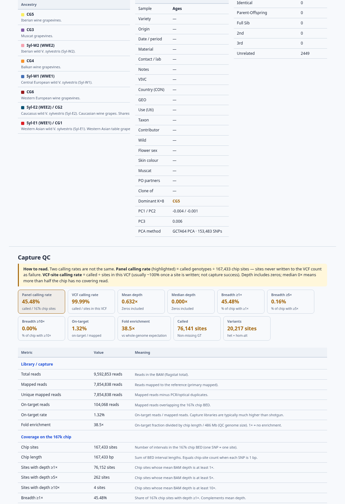

样本有效性：167K 位点上的捕获质控（深度、calling 率、on-target 率）。

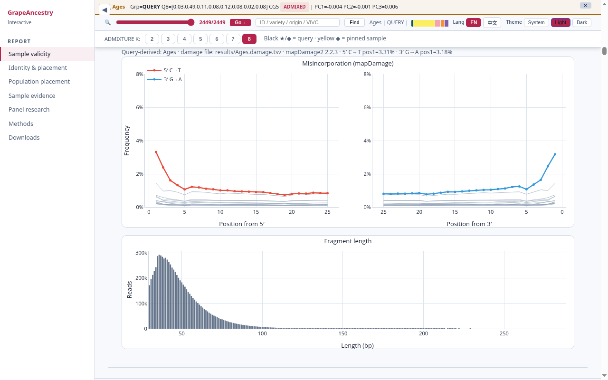

aDNA 损伤：末端错配与片段长度模式（Ages）。

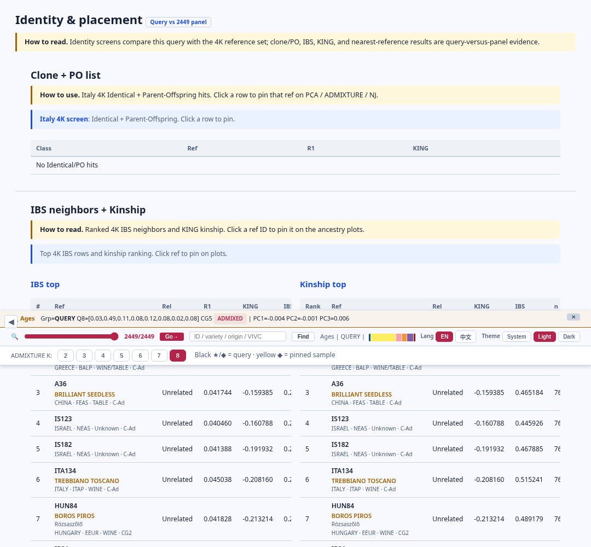

身份鉴定：Ages 克隆与亲子关系筛查，以及与固定面板的 IBS 亲缘关系。

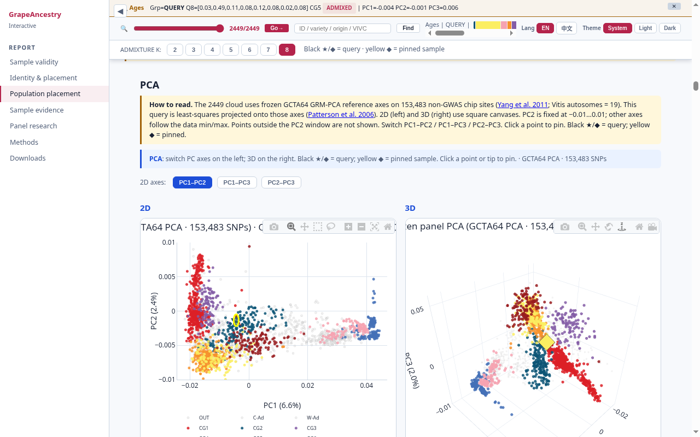

群体结构：样本投影到固定的 GCTA64 PCA 轴上（VS-1 坐标系）。

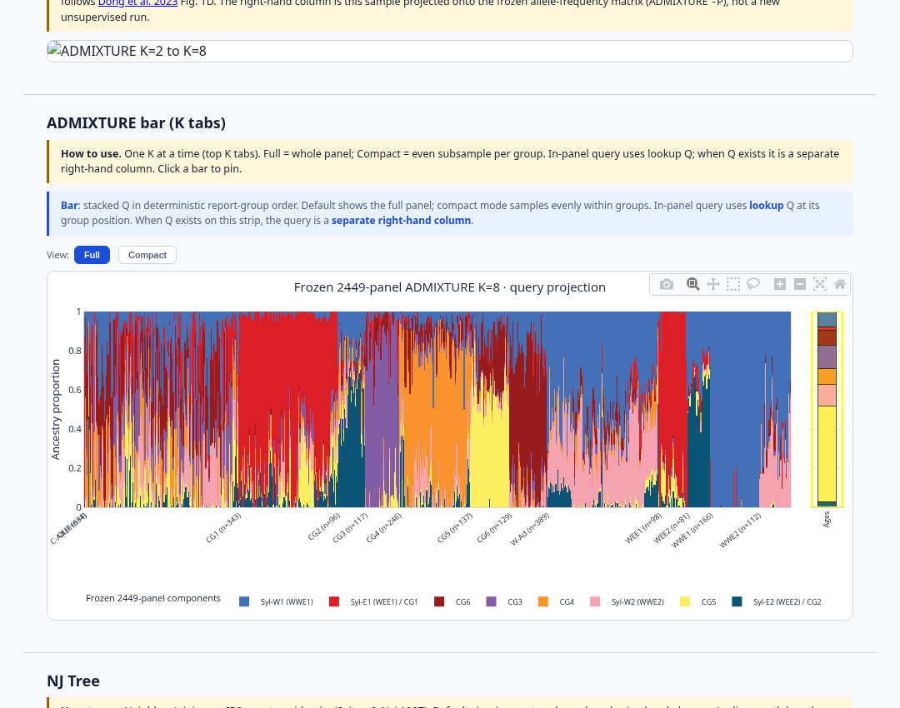

群体结构：使用固定 Q/P 阵列的 K=2–8 ADMIXTURE 结果（未进行 2449+N 重新计算）。

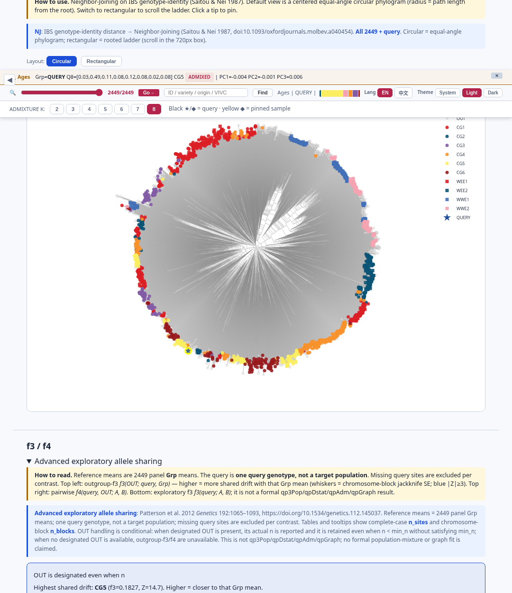

群体结构：IBS 邻接树（需配合身份鉴定表使用）。

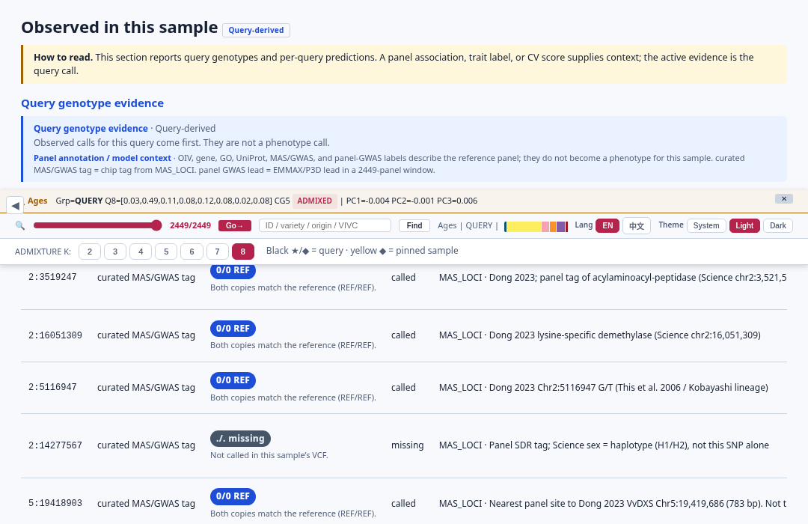

样本证据：仅 OIV 225 颜色基因组得分具有判定级效力（得分 ≠ 表型）。SDR 仍作为代理指标。

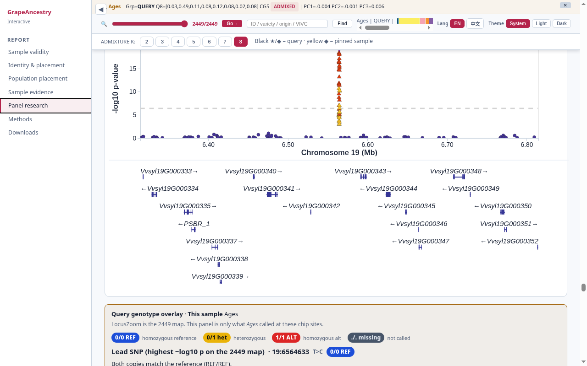

面板研究：带有样本基因型叠加显示的 LocusZoom 区域面板图（叠加显示 ≠ “此样本被选中”）。

## 文档

| 文档 | 作用 |
|-----|------|
| [`DATA_NOTICE.md`](DATA_NOTICE.md) | 说明 git 中包含/不包含的内容；Docker tar 包策略 |
| [`demo/`](demo/) | 28 颗种子的批量 HTML 报告（仅供浏览） |
| [`steps/`](steps/) | 手动构建的 `00a`–`13b` 步骤 |
| [`docs/USER_GUIDE.md`](docs/USER_GUIDE.md) | 启动套件与浏览；BAM 数据导入 |
| [`docs/GUIDELINE.md`](docs/GUIDELINE.md) | 报告阅读指南 |
| [`docs/FAQ.md`](docs/FAQ.md) | 初始上手帮助 |
| [`docs/GLOSSARY.md`](docs/GLOSSARY.md) | 术语表（167K 与 2449） |
| [`REPO_MAP.md`](REPO_MAP.md) | 各顶级目录的内容说明 |
| [`docs/CODE_AVAILABILITY.md`](docs/CODE_AVAILABILITY.md) | Git 链接及 Docker / Zenodo 说明 |
| [`docs/FLOWCHART.md`](docs/FLOWCHART.md) | 流程图的推论边界说明 |

## 作者

李旭真，[ORCID 0000-0003-3670-6657](https://orcid.org/0000-0003-3670-6657)

相关项目：[gtbs-chip-service-kit](https://github.com/Xuzhen-Li/gtbs-chip-service-kit)，[grapevine-adna](https://github.com/Xuzhen-Li/grapevine-adna)，[genomics-theory-mining](https://github.com/Xuzhen-Li/genomics-theory-mining)

## 早期流程图

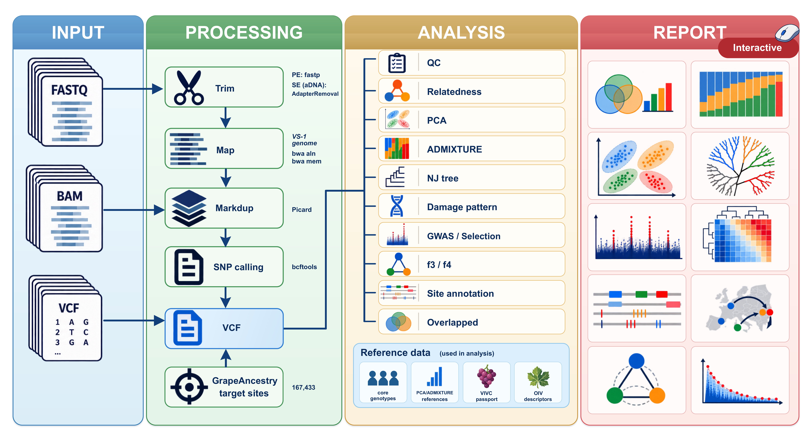

旧版图示。当前的概览图请见“分析流程”章节。